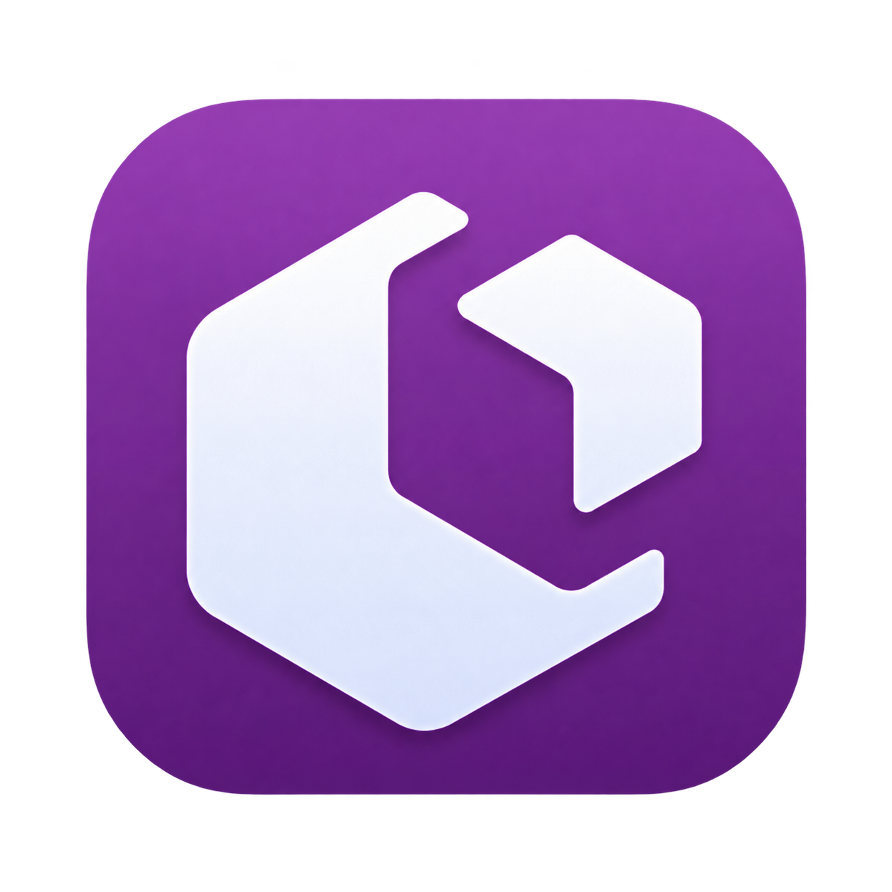
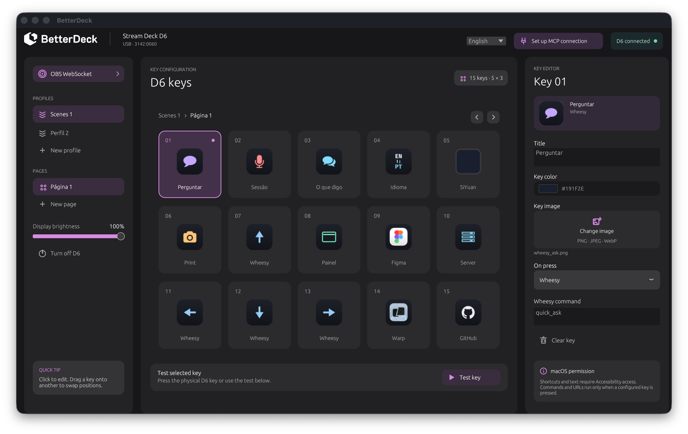

<div align="center">
  

  <h1>BetterDeck</h1>

  <p><strong>A native macOS control surface for the FIFINE AmpliGame D6.</strong></p>

  <p>Built with Rust and egui. Configure your keys, run actions, control OBS Studio, and let local AI agents manage your deck through MCP.</p>

  <p><a href="#get-started">Get started</a> · <a href="#features">Features</a> · <a href="#mcp-integration">MCP integration</a> · <a href="#development">Development</a></p>
</div>

---

<p align="center">
  
</p>

## At a glance

| | |
| --- | --- |
| **Platform** | macOS 12 or later |
| **Hardware** | FIFINE AmpliGame D6, 15 keys with 112 × 112 displays |
| **Tested device** | USB `3142:0060` (revision 2) |
| **Additional driver support** | USB `3142:0007` (revision 1; not yet tested on hardware) |
| **Stack** | Rust, egui, USB HID, local MCP over stdio |

BetterDeck is an independent project. It talks directly to the D6 over USB HID and can import profiles from an installed FIFINE Control Deck without modifying the original files.

## Features

- **Make the deck yours.** Organize 15 keys across profiles and pages. Set titles, colors, and PNG, JPEG, or WebP images. Drag one key onto another to swap their positions with an animation.
- **Run useful actions.** Open apps, files, and websites; send keyboard shortcuts or text; control media, volume, and display brightness; switch pages or profiles; run shell commands, HTTP GET requests, delays, and sequences.
- **Control OBS Studio.** Connect to obs-websocket 5 to toggle recording, streaming, the virtual camera, input mute, source visibility, and Studio Mode, or switch scenes.
- **Stay connected.** Upload key images as JPEG over HID, respond to physical key presses, reconnect when the device returns, and turn the display on or off.
- **Work from the menu bar.** Closing the window hides BetterDeck from the Dock while it continues running. Click its menu bar icon to reopen it, or right-click the icon and choose **Quit** to exit.
- **Choose your language.** Switch between English and Brazilian Portuguese from the header. The selection is saved and also updates the menu bar commands.
- **Bring your existing setup.** Import supported actions and images from FIFINE profiles, including Wheesy Unix socket macros and Warp tab/SSH actions. Unsupported plugin settings are preserved for later migration.
- **Automate with MCP.** Local agents can inspect the deck, create profiles and pages, configure keys, trigger actions, and control device settings.

## Get started

### Requirements

- macOS 12 or later
- A [Rust toolchain](https://rustup.rs/) with Cargo
- A FIFINE AmpliGame D6 connected over USB

Quit **FIFINE Control Deck** before using BetterDeck so both apps do not write to the device at the same time.

From the project directory, run:

```sh
cargo run --release
```

To build a macOS app bundle instead:

```sh
./scripts/package-macos.sh
open dist/BetterDeck.app
```

The packaging script builds a release binary, creates the app icon, and ad hoc signs `dist/BetterDeck.app`.

On first launch, BetterDeck looks for FIFINE profiles in `~/Library/Application Support/HotSpot/StreamDock/profiles`. It stores its own configuration at `~/Library/Application Support/dev.betterdeck.BetterDeck/deck.json` with `0600` permissions.

> **macOS permission:** Keyboard shortcuts and text actions need Accessibility access for BetterDeck in System Settings.

## MCP integration

BetterDeck includes a local [Model Context Protocol](https://modelcontextprotocol.io/) server for Claude Code, Codex, and other stdio MCP clients. Keep the main app running, even if its window is hidden in the menu bar, then launch a second instance of the executable with `--mcp`.

```text
MCP client → BetterDeck --mcp → local Unix socket → running app → D6
```

The app's bridge uses a Unix socket in the user's configuration directory with `0600` permissions; it does not open a network port. `get_deck` excludes the stored OBS password.

The repository includes example client settings in [`.mcp.json.example`](.mcp.json.example) and [`.codex/config.toml.example`](.codex/config.toml.example). Copy the example for your client and change `command` to the absolute path of your built executable, for example:

```text
/absolute/path/to/betterdeck/dist/BetterDeck.app/Contents/MacOS/BetterDeck
```

Pass `--mcp` as the argument. The **Setup MCP Connection** button in the app also provides configuration snippets to copy into other clients.

### Available tools

| Tool | Purpose |
| --- | --- |
| `get_status`, `get_deck` | Read connection state, active selections, and deck configuration |
| `create_profile`, `create_page` | Create and select a profile or page |
| `set_active_profile`, `set_active_page` | Select by zero-based index |
| `configure_key`, `clear_key`, `press_key` | Edit, clear, or run a key on the active page |
| `set_brightness`, `set_sleep` | Control display brightness and sleep state |
| `set_obs_connection` | Set the OBS WebSocket address and optional password |

Keys are numbered **1–15**. Profile and page indices start at **0**. `configure_key` accepts an action in the app's tagged JSON format, such as:

```json
{"type":"Open","value":"https://example.com"}
```

```json
{"type":"Hotkey","value":"cmd+shift+4"}
```

Configuration changes from MCP appear in the app and are sent to the connected D6. `press_key` runs the assigned action, including shell commands when a key is configured to use one, so connect only MCP clients you trust.

## Development

Useful diagnostics are available from the project directory:

```sh
cargo run -- --probe
cargo run -- --import-preview
cargo run -- --hardware-test
```

`--probe` inspects the HID device. `--import-preview` summarizes profiles available for import. `--hardware-test` sends a test image to key 1; the next profile refresh replaces it.

Before contributing code, run:

```sh
cargo fmt --check
cargo test
cargo clippy --all-targets -- -D warnings
```

The [reverse engineering notes](research/REVERSE_ENGINEERING.md) document the protocol evidence, tested hardware, and remaining verification work.

## Current limitations

- Third-party FIFINE plugins are not executed automatically. Imported plugin UUIDs and settings remain in the configuration for future compatibility work.
- The original app's plugin store, animated backgrounds, and online service integrations have no equivalent yet.
- Revision 1 (`3142:0007`) hardware support is implemented but has not been tested on a physical device. Revision 2 (`3142:0060`) JPEGs are rotated before upload to account for the display orientation; the result still needs a visual retest.
- OBS credentials are stored in the local permissions-protected JSON configuration, not in macOS Keychain.

## License

No license file has been added to this repository yet.
